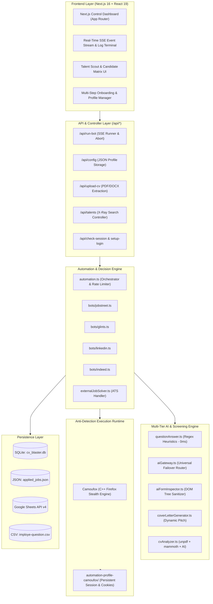
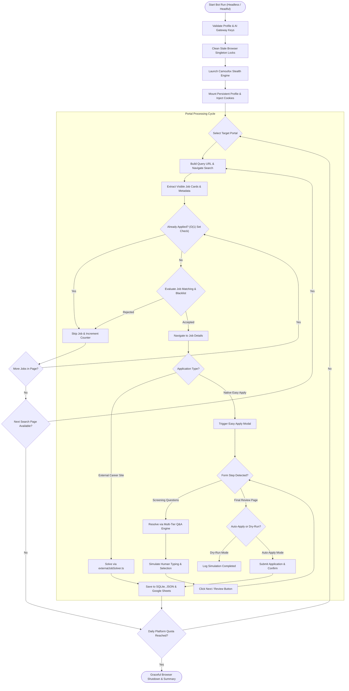
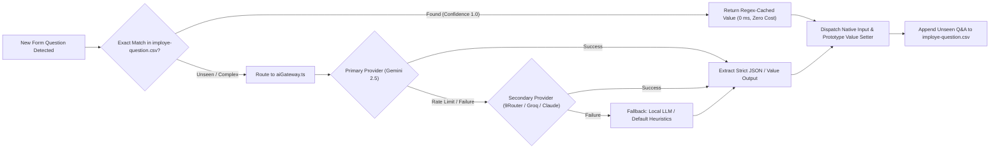
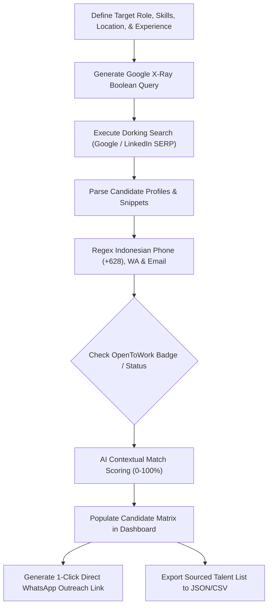

<div align="center">

<picture>
  <source media="(prefers-color-scheme: dark)" srcset="public/brand/logo-dark.svg">
  <source media="(prefers-color-scheme: light)" srcset="public/brand/logo-light.svg">
  
</picture>

# AutoApply

### Autonomous AI-Powered Multi-Platform Job Application Engine & Reverse Talent Scout

*Streamline your job hunt with intelligent automation across JobStreet, Glints, LinkedIn Easy Apply, Indeed, and External ATS portals.*

[](https://nextjs.org/)
[](https://react.dev/)
[](https://www.typescriptlang.org/)
[](https://tailwindcss.com/)
[](https://github.com/daijro/camoufox)
[](https://ai.google.dev/)
[](https://developer.chrome.com/docs/extensions/mv3/)
[](LICENSE)

<br />

<p align="center">
  <b>Tired of sending hundreds of job applications manually and filling repetitive screening questionnaires?</b><br />
  <b>AutoApply</b> is a production-grade, open-source automation suite that searches, filters, dynamically customizes cover letters, auto-solves HR screening questionnaires using high-speed heuristics and LLMs, and safely applies on your behalf while you prepare for interviews.
</p>

</div>

---

## 📑 Table of Contents

- [Key Highlights](#-key-highlights)
- [System Architecture & Workflows](#-system-architecture--workflows)
  - [1. High-Level System Architecture](#1-high-level-system-architecture)
  - [2. End-to-End Autonomous Application Pipeline](#2-end-to-end-autonomous-application-pipeline)
  - [3. Multi-Tier AI Screening Question Solver](#3-multi-tier-ai-screening-question-solver)
  - [4. Reverse Talent Scout Pipeline](#4-reverse-talent-scout-pipeline)
- [Visual Showcase & Dashboard](#-visual-showcase--dashboard)
- [Execution Modes](#-execution-modes)
- [Quick Start Guide](#-quick-start-guide)
  - [Prerequisites](#prerequisites)
  - [Installation (Local Desktop)](#installation-local-desktop)
  - [Setup Browser Sessions & Portal Login](#setup-browser-sessions--portal-login)
  - [Running the Application](#running-the-application)
- [Configuration Reference (`config.json`)](#-configuration-reference-configjson)
- [Anti-Detection Engineering & Operational Safety](#-anti-detection-engineering--operational-safety)
  - [Stealth Browser Engines](#stealth-browser-engines)
  - [Human Behavioral Emulation](#human-behavioral-emulation)
  - [Recommended Safe Daily Quotas](#recommended-safe-daily-quotas)
- [Multi-Tier Question Answering Engine](#-multi-tier-question-answering-engine)
- [Reverse Talent Scout & Headhunting](#-reverse-talent-scout--headhunting)
- [Companion Chrome Extensions](#-companion-chrome-extensions)
- [REST API & Server-Sent Events (SSE)](#-rest-api--server-sent-events-sse)
- [Project Directory Structure](#-project-directory-structure)
- [Troubleshooting & FAQ](#-troubleshooting--faq)
- [Data Privacy & Security](#-data-privacy--security)
- [Easter Egg & Supporter Corner](#-easter-egg--supporter-corner)
- [License & Disclaimer](#-license--disclaimer)

---

## 🌟 Key Highlights

- **Multi-Portal Native Automation:** Full support for **JobStreet**, **Glints**, **LinkedIn (Easy Apply)**, and **Indeed (Indeed Apply)**.
- **Universal External ATS Solver:** Automatically identifies and applies to external career boards (Greenhouse, Lever, Workday, Ashby, BambooHR, SmartRecruiters) using automated resume uploading and AI form inspection.
- **Hardened C++ Anti-Detection Browser Engine:**
  - **Camoufox C++ Engine (`camoufox-js`):** Built on top of a customized C++ Firefox fork specifically patched to eliminate browser automation leaks. Features hardware spoofing (WebGL, Canvas, AudioContext, OS fingerprinting) and natural human cursor kinematics to reliably bypass Cloudflare Turnstile, DataDome, and bot scoring without requiring external Google Chrome installations.
- **Multi-Tier Decision & Questionnaire Solver:**
  - **Tier 1 (Instant Cache):** 0ms Regex/Keyword heuristics from an indexed database of 1,000+ HR questions (`imploye-question.csv`).
  - **Tier 2 (Universal AI Gateway):** Contextual generation via Google Gemini (`gemini-2.5-flash`), OpenAI-compatible providers (9Router, OpenRouter, Groq, Ollama, DeepSeek), and Anthropic Claude with automatic failover chaining.
  - **Tier 3 (AI DOM Form Inspector):** Sanitizes active interactive modal DOM structures and sends them to AI for precise target coordinate resolution on custom UI frameworks (React, Shadow DOM, customized selects).
- **Tailored AI Cover Letter Generation:** Generates concise, role-specific, and persuasive 1–2 paragraph motivation letters on-the-fly based on job description context and applicant CV data.
- **Job Matching & Blacklisting:** Dynamic qualification scoring (0–100%), negative keyword filtering (`intern`, `unpaid`, `field sales`, etc.), and employer blacklisting to prevent accidental applications to current companies.
- **Reverse Talent Scout (HR Mode):** Google X-Ray Boolean dorking for Indonesian LinkedIn profiles, contact extraction (phone, WhatsApp, email), OpenToWork badge filtering, and 1-click WhatsApp outreach templating.
- **Tri-Engine Data Storage:** Synchronize application records to local **SQLite** (`cv_blaster.db`), portable **JSON** (`applied_jobs.json`), or cloud **Google Sheets** for remote collaborative monitoring.
- **Client Companion & Standalone Extensions:** Chrome Manifest V3 extensions for 1-click cookie synchronization or 100% serverless, zero-backend in-browser execution.

---

## 📐 System Architecture & Workflows

### 1. High-Level System Architecture



---

### 2. End-to-End Autonomous Application Pipeline



---

### 3. Multi-Tier AI Screening Question Solver



---

### 4. Reverse Talent Scout Pipeline



---

## 📸 Visual Showcase & Dashboard

<div align="center">

### Unified Control Center & Live Multi-Portal Operations


<table width="100%">
  <tr>
    <td width="50%" align="center">
      <b>Comprehensive Application Audit & Real Q&A Ledger</b><br><br>
      
    </td>
    <td width="50%" align="center">
      <b>Database of 1,000+ HR Screening Questions & Regex Rules</b><br><br>
      
    </td>
  </tr>
  <tr>
    <td width="50%" align="center">
      <b>Interactive Guided Onboarding Tour</b><br><br>
      
    </td>
    <td width="50%" align="center">
      <b>Live SSE Terminal Monitor & Event Streaming</b><br><br>
      
    </td>
  </tr>
</table>

</div>

---

## 🕹️ Execution Modes

| Mode | Target User | Requirement | Architecture | Description |
| :--- | :--- | :--- | :--- | :--- |
| **1. Local Desktop Web GUI** *(Recommended)* | Daily job seekers on PC / Laptop | Node.js 20+ | Next.js 16 + Camoufox Stealth | Full interactive graphical dashboard with live terminal, visual headful/headless toggle, profile manager, and questionnaire editor. |
| **2. Standalone Chrome Extension** | Zero-install / Serverless users | Google Chrome | Manifest V3 In-Tab Content Script | Operates 100% inside your standard browser tabs without needing Node.js or a backend server. Uses client-side AI API keys. |
| **3. Cloud VPS / Linux Server** | Advanced users running 24/7 automation | Ubuntu / Debian VPS | Node.js 20+ & PM2 + Nginx | Headless background runner on cloud instances with web dashboard accessible via custom domain & SSL. |
| **4. 24/7 Home Residential Gateway** | Stealth purists avoiding data center IPs | Mini-PC, Raspberry Pi, or Android Termux | Node.js + Home Wi-Fi | Bypasses 100% of Cloudflare Turnstile bot checks by executing requests through genuine residential ISP connections without paid proxies. |

---

## ⚡ Quick Start Guide

### Prerequisites

- **Node.js**: v20.x or higher (LTS recommended).
- **Stealth Browser**: Built-in Camoufox C++ engine automatically managed via `camoufox-js` (no manual Google Chrome setup required).
- **AI API Key**: Free Google Gemini API Key from [Google AI Studio](https://aistudio.google.com/) or an OpenAI-compatible endpoint key (9Router, OpenRouter, Groq).

### Installation (Local Desktop)

```bash
# 1. Clone the repository
git clone https://github.com/itzluthfi/Bot-Lempar-Jaring-Loker.git
cd Bot-Lempar-Jaring-Loker

# 2. Install dependencies
npm install

# 3. Create your initial configuration file
cp config.example.json config.json
```

### Setup Browser Sessions & Portal Login

Because modern job portals utilize 2FA, OTPs, and Cloudflare challenges, logging in inside an automated bot runner using credentials directly is easily flagged. **Lempar Jaring solves this elegantly via Persistent Browser Profiles:**

1. Run the local development server:
   ```bash
   npm run dev
   ```
2. Open **`http://localhost:3000`** in your browser.
3. In the left sidebar or the platform setup card, click **"Buka Browser (Login Setup)"** for your desired platform (JobStreet, Glints, LinkedIn, Indeed).
4. A dedicated stealth browser window will launch. Log in to your accounts manually as you normally would (Google OAuth, SMS OTP, and 2FA are fully supported).
5. Once logged in, simply **close the browser window**. All session cookies and storage tokens are permanently stored inside `automation-profile-camoufox/`. You do not need to log in again.

> [!TIP]
> **Alternative Cookie Sync:** If you already have active sessions in your everyday Google Chrome, install the companion extension located in `extension/`, click **"Sync Cookies ke Web"**, and your sessions will be automatically imported into `config.json`.

---

## ⚙️ Configuration Reference (`config.json`)

Configuration settings are stored in `config.json` at the project root and can be modified directly or updated via the Web UI:

```jsonc
{
  // Storage backend: 'sqlite' | 'json' | 'sheets'
  "storageType": "sqlite",
  "spreadsheetId": "",
  "sheetName": "Sheet1",
  "googleCredentialsJson": "",

  // Job Search Parameters
  "searchKeywords": "Frontend Developer",
  "location": "Jakarta",
  "minSalary": "5000000",
  "datePosted": "week",                 // '24h' | 'week' | 'month' | ''
  "jobType": ["full_time"],             // 'full_time', 'part_time', 'contract'
  "workMode": ["hybrid", "remote"],      // 'remote', 'hybrid', 'on_site'

  // Application Quotas & Scheduling
  "limitMode": "shared",                // 'shared' (total across all) | 'per_platform'
  "limitPerDay": 30,
  "limitJobstreet": 15,
  "limitGlints": 15,
  "limitLinkedin": 10,
  "limitIndeed": 15,

  // Platform Toggles
  "enableJobstreet": true,
  "enableGlints": true,
  "enableLinkedin": true,
  "enableIndeed": true,

  // Anti-Detection & Engine
  "browserEngine": "camoufox",         // Mandatory stealth engine
  "enableHumanStealth": true,           // Natural typing jitter & mouse paths
  "autoApplyMode": "auto",              // 'auto' (submit) | 'review' (dry-run simulation)

  // Candidate Profile (Used by Multi-Tier Question Answering Engine)
  "fullName": "Jane Doe",
  "email": "janedoe@example.com",
  "phoneNumber": "081234567890",
  "gender": "Perempuan",
  "maritalStatus": "Single",
  "expectedSalary": 7500000,
  "educationLevel": "Sarjana (S1)",
  "yearsOfExperience": 3,
  "skills": "React, TypeScript, Next.js, Node.js, Tailwind CSS, PostgreSQL",
  "portfolioUrl": "https://janedoe.dev",
  "githubUrl": "https://github.com/janedoe",
  "linkedinUrl": "https://linkedin.com/in/janedoe",
  "domicile": "Jakarta Selatan",

  // Multi-Provider AI Gateway
  "aiProvider": "gemini",
  "activeAiEndpointId": "ep-gemini",
  "aiEndpoints": [
    {
      "id": "ep-gemini",
      "name": "Google Gemini 2.5",
      "type": "gemini",
      "baseUrl": "",
      "apiKey": "AIzaSy...",
      "model": "gemini-2.5-flash",
      "isActive": true
    },
    {
      "id": "ep-custom-router",
      "name": "9Router AI Gateway",
      "type": "openai_compatible",
      "baseUrl": "https://api.9router.com/v1",
      "apiKey": "sk-...",
      "model": "google/gemini-2.5-flash",
      "isActive": false
    }
  ],

  // Match Scoring & Blacklisting
  "enableJobMatchFilter": true,
  "minMatchScore": 60,
  "negativeKeywords": "magang, intern, unpaid, sales lapangan, mandarin",
  "blacklistedCompanies": "PT Scam Indonesia, Current Employer Corp"
}
```

---

## 🛡️ Anti-Detection Engineering & Operational Safety

### Stealth Browser Engine (Camoufox C++)

- Built on top of a customized C++ Firefox fork specifically patched to eliminate browser automation leaks.
- Strips `navigator.webdriver` and CDP (Chrome DevTools Protocol) signals that trigger Cloudflare Turnstile and Akamai.
- Injects realistic GPU and WebGL hardware noise, Canvas fingerprints, and AudioContext signatures at the native level.
- Includes real human cursor movement simulation powered by natural mathematical splines.
- Automatic termination of orphan processes on Windows holding file locks on user data profiles via PowerShell WMI scripts.

### Human Behavioral Emulation

- **Keystroke Jitter (`humanType`):** Character-by-character typing with randomized delays (35ms – 120ms), punctuation micro-hesitations (180ms – 450ms), and occasional simulated human reading pauses.
- **Smooth Natural Scrolling:** Incremental easing curves and random view pauses to trigger lazy-loaded job listing cards without alerting velocity monitors.
- **Session Warming:** Automatically visits home feeds (`https://id.indeed.com/`, `https://www.linkedin.com/feed/`) prior to navigating directly into deep search URLs to initialize Cloudflare cookies and session state.

### Recommended Safe Daily Quotas

To keep your job portal accounts healthy, safe, and below velocity detection thresholds, follow these operational bounds:

| Job Portal | Daily Safe Quota | Delay Between Jobs | Recommended Operating Window |
| :--- | :--- | :--- | :--- |
| **JobStreet Indonesia** | 20 – 35 jobs/day | 15 – 35 seconds | 08:30 – 17:00 (Local Time) |
| **Indeed Indonesia** | 25 – 50 jobs/day | 20 – 45 seconds | 08:00 – 20:00 (Local Time) |
| **Glints Indonesia** | 15 – 30 jobs/day | 25 – 50 seconds | 09:00 – 18:00 (Local Time) |
| **LinkedIn (Easy Apply)** | 10 – 20 jobs/day | 45 – 90 seconds | 09:00 – 16:30 (Local Time) |

---

## 🧠 Multi-Tier Question Answering Engine

Job applications frequently require answering screening questionnaires (e.g., *"How many years of experience do you have with TypeScript?"*, *"Are you willing to work in South Jakarta?"*, *"Notice period?"*).

Lempar Jaring processes questions through a prioritized three-tier architecture:

```
[ Question Detected in Form ]
              │
              ▼
   ┌───────────────────────┐
   │  Tier 1: Regex Cache  │ ──► Match found? ──► Inject Answer Immediately (0 ms, 0 API cost)
   └───────────────────────┘
              │ No
              ▼
   ┌───────────────────────┐
   │ Tier 2: Multi-AI Gate │ ──► Call Gemini 2.5 / Claude / OpenAI API with Candidate Profile Context
   └───────────────────────┘
              │ Failure / Custom Modal
              ▼
   ┌───────────────────────┐
   │ Tier 3: DOM Inspector │ ──► Capture sanitized DOM tree, identify dynamic selects, radios & submit buttons
   └───────────────────────┘
```

1. **Instant Heuristic Engine (`imploye-question.csv`):** Over 1,000 common HR questionnaire variations pre-mapped to exact profile attributes. Evaluated locally in microseconds with zero token consumption.
2. **Universal AI Gateway (`aiGateway.ts`):** Contextual completion supporting structured JSON output. If the primary provider (e.g., Google Gemini) hits a rate limit or network glitch, requests automatically failover to secondary endpoints (e.g., 9Router or Groq).
3. **AI DOM Vision Inspector (`aiFormInspector.ts`):** Handles non-standard form controls (e.g., custom styled div dropdowns, shadow DOM radio buttons, stepper navigators). Generates an interactive DOM map, identifies target selectors with temporary `data-ai-inspect-id` tags, and injects answers into React prototype state setters.

---

## 🔍 Reverse Talent Scout & Headhunting

Lempar Jaring includes a dedicated **Talent Scout** suite for HR professionals, recruiters, and tech leads looking to discover top Indonesian talent:

- **Google X-Ray Boolean Dorking:** Generates optimized queries targeting public LinkedIn Indonesia profiles (`site:id.linkedin.com/in/`) to bypass commercial LinkedIn Recruiter search limits.
- **Contact Extraction:** Regular expression extraction for Indonesian mobile and WhatsApp numbers (`+628...`, `08...`) and email addresses published in biographical summaries.
- **Filter by OpenToWork:** Isolate candidates actively looking for roles.
- **AI Candidate Matching:** Calculates match percentage against a job description or skill criteria using AI contextual analysis.
- **1-Click WhatsApp Outreach:** Generates formatted WhatsApp click-to-chat links (`wa.me/...`) pre-populated with a personalized recruitment pitch.

---

## 🧩 Companion Chrome Extensions

The repository includes two Chrome Extensions located in `extension/` and `extension-standalone/`:

### 1. Companion Session Synchronizer (`extension/`)
- **Purpose:** Extracts your active authenticated session cookies from JobStreet, Glints, LinkedIn, and Indeed in your personal Chrome browser and transfers them to the Lempar Jaring local server.
- **Installation:**
  1. Go to `chrome://extensions/` in Google Chrome.
  2. Enable **Developer mode** (top-right switch).
  3. Click **Load unpacked** and select the `extension/` directory.
  4. Open the extension popup and click **"Sync Cookies ke Web"**.

### 2. Standalone Serverless Extension (`extension-standalone/`)
- **Purpose:** Run automations directly in your browser without running a local Node.js backend.
- **Installation:** Load unpacked from the `extension-standalone/` directory.

---

## 🔌 REST API & Server-Sent Events (SSE)

The backend provides REST and streaming API endpoints:

| Endpoint | Method | Description |
| :--- | :--- | :--- |
| `/api/run-bot` | `GET` | Starts the automation runner. Streams live terminal logs via Server-Sent Events (`text/event-stream`). Query parameters: `mode=headless|headful`, `platform=all|glints|jobstreet|linkedin|indeed`, `limit=number`. |
| `/api/run-bot` | `POST` | Emits a graceful cancellation signal to stop running bot loops. |
| `/api/config` | `GET` / `POST` | Reads and updates configuration settings in `config.json`. |
| `/api/upload-cv` | `POST` | Accepts PDF/DOCX file uploads, extracts raw text via `unpdf` or `mammoth`, and uses AI to auto-populate candidate profile fields. |
| `/api/applied` | `GET` / `DELETE` | Retrieves applied job records from SQLite / JSON or clears historical records. |
| `/api/questions` | `GET` / `POST` | Manages screening question rows in `imploye-question.csv`. |
| `/api/setup-login` | `POST` | Launches a visible browser window for manual login with profile persistence. |
| `/api/check-session` | `GET` | Checks whether saved profiles or injected cookies have valid login sessions on target portals. |
| `/api/test-ai` | `POST` | Validates API keys and response latency for Gemini or OpenAI-compatible endpoints. |
| `/api/talents` | `GET` / `POST` | Retrieves or saves sourced candidate profiles in the Talent Scout module. |

---

## 📂 Project Directory Structure

```
Bot-Lempar-Jaring-Loker/
├── config.example.json           # Template configuration file
├── cv_blaster.db                 # SQLite database for application tracking
├── applied_jobs.json             # Portable JSON backup of applied jobs
├── start-cvblaster.bat           # 1-Click Windows launch script
├── extension/                    # Chrome Extension (Manifest V3) for cookie synchronization
│   ├── manifest.json             # Permissions and extension metadata
│   ├── background.js             # Service worker and cookie bridge
│   └── popup/                    # Sync popup UI
├── extension-standalone/         # Standalone in-browser bot (Serverless)
├── public/
│   ├── imploye-question.csv      # Screening question knowledge base (1,000+ entries)
│   └── ...                       # Static icons and logos
├── docs/
│   └── screenshots/              # Application user interface screenshots
└── src/
    ├── app/                      # Next.js 16 App Router
    │   ├── api/                  # Backend REST & SSE route handlers
    │   │   ├── applied/          # Application history controller
    │   │   ├── config/           # App configuration controller
    │   │   ├── run-bot/          # SSE bot execution runner
    │   │   ├── setup-login/      # Interactive browser session launcher
    │   │   ├── upload-cv/        # Resume text extraction & AI profiling
    │   │   └── ...
    │   ├── layout.tsx            # Root layout wrapper
    │   └── page.tsx              # Interactive full-featured web dashboard
    ├── components/               # React 19 UI components
    │   ├── BatchQuestionModal.tsx# Modal for editing question bank entries
    │   ├── JobCard.tsx           # Application history job card component
    │   ├── OnboardingTour.tsx    # 10-step interactive tutorial tour
    │   └── TalentScoutTab.tsx    # Reverse Talent Scout matrix and search interface
    └── lib/                      # Core automation and helper utilities
        ├── bots/                 # Platform-specific bot implementations
        │   ├── glints.ts         # Glints automation runner
        │   ├── indeed.ts         # Indeed automation runner
        │   ├── jobstreet.ts      # JobStreet automation runner
        │   └── linkedin.ts       # LinkedIn Easy Apply runner
        ├── aiFormInspector.ts    # DOM snapshot analyzer for dynamic modals
        ├── aiGateway.ts          # Universal multi-provider AI completion gateway
        ├── automation.ts         # Master bot coordinator & platform loop
        ├── browserHelper.ts      # Camoufox & Puppeteer-Extra launch manager
        ├── config.ts             # Typed configuration loader & validator
        ├── cookieHelper.ts       # Cookie parser and injection utility
        ├── coverLetterGenerator.ts # Role-tailored dynamic cover letter generator
        ├── cvAnalyzer.ts         # PDF (unpdf) & DOCX (mammoth) AI parsing
        ├── externalJobSolver.ts  # External ATS career board solver (Greenhouse, etc.)
        ├── googleSheets.ts       # Google Sheets v4 API integration
        ├── humanStealth.ts       # Natural human typing jitter and scroll helpers
        ├── jobMatcher.ts         # Candidate-to-job qualification match evaluator
        ├── questionAnswer.ts     # Multi-tier screening question resolution engine
        ├── storage.ts            # Tri-engine persistence (SQLite, JSON, Sheets)
        └── xraySearch.ts         # Google X-Ray query builder and contact extractor
```

---

## ❓ Troubleshooting & FAQ

<details>
<summary><b>1. Browser crashes or displays "The browser is already running for... Use a different userDataDir"</b></summary>

Lempar Jaring includes an automatic cleanup mechanism (`cleanupStaleProfileLocks`) that kills zombie Camoufox instances and unlinks lock files. If you still encounter this after an unexpected reboot:
1. Close all browser windows.
2. Delete the lock files manually inside `automation-profile-camoufox/`:
   ```bash
   rm automation-profile-camoufox/parent.lock
   ```
</details>

<details>
<summary><b>2. Bot gets stuck on Cloudflare Turnstile or captcha challenge</b></summary>

- Camoufox C++ Stealth Browser handles Turnstile challenges automatically with humanized cursor movements.
- Avoid datacenter VPNs or commercial proxy IPs. Use your genuine home residential internet connection.
- Use **"Buka Browser (Login Setup)"** once in headful mode to complete any initial 2FA/challenge manually; your authenticated session token will persist.
</details>

<details>
<summary><b>3. Why are some jobs skipped automatically?</b></summary>

A job is skipped if:
1. You have already applied to it previously (verified via clean URL matching in `applied_jobs.json` / SQLite in $O(1)$ time).
2. The job title or description matches your `negativeKeywords` list (e.g., `magang`, `unpaid`).
3. The company matches your `blacklistedCompanies` list.
4. If `enableJobMatchFilter` is active and the calculated match score falls below `minMatchScore`.
</details>

---

## 🔒 Data Privacy & Security

1. **Local-First Architecture:** All candidate personal data, resumes, session cookies, and application logs remain strictly stored on your local machine.
2. **Git Pre-Configured Protection:** Sensitive files including `config.json`, `applied_jobs.json`, `cv_blaster.db`, `automation-profile*`, and `uploads/` are explicitly listed in `.gitignore` to prevent accidental commits to public repositories.
3. **No Centralized Tracking:** Lempar Jaring does not phone home or transmit telemetry to any third-party analytics servers.

---

## ☕ Easter Egg & Supporter Corner

<details>
<summary>🚨 <b>SECRET SYSTEM ARTIFACT: OPEN AT YOUR OWN RISK...</b></summary>

<br>

<div align="center">

### You unlocked the developer's coffee sanctuary!

If **Lempar Jaring** saved your fingertips from repetitive manual clicking, helped you dodge boring screening forms, or boosted your application throughput:

<br />


<br /><br />


<br /><br />

<p>
  <b>Scan the Indonesian QRIS code above to treat the developer to a warm cup of coffee.</b><br />
  <i>May your job applications land interviews without ghosting drama!</i>
</p>

</div>

</details>

---

## 📄 License & Disclaimer

This project is licensed under the **[MIT License](LICENSE)**.

### Disclaimer
*This software is developed strictly for educational, personal productivity, and research purposes. Users are solely responsible for complying with the Terms of Service of respective job platforms (JobStreet, Glints, LinkedIn, Indeed) and setting sensible daily application limits. The creators and contributors assume no liability for misuse, account restrictions, or platform actions resulting from the use of this tool.*

<br />

<div align="center">
  <sub>Built with care for job seekers, career switchers, and talent scouts everywhere.</sub><br />
  <b>Lempar Jaring &copy; 2026. Automated with Precision.</b>
</div>
